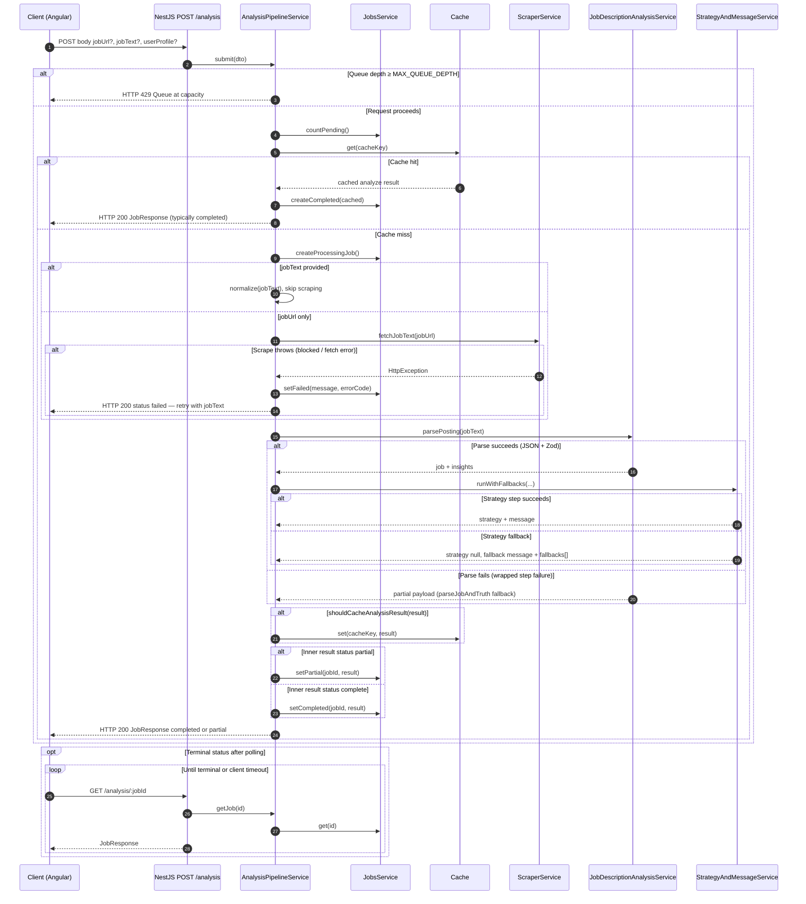

# hire-path-jobs

AI-powered job analysis app.

Built with **Angular** (web) + **NestJS** (API) + **TypeScript** + **DeepSeek**.

---

## How it works

1. `POST /api/analysis` with a job posting URL (`jobUrl`) or pasted text (`jobText`)
2. Backend tries to fetch and extract the job description text (scrape step)
3. Text is normalized (cleanup / whitespace / dedupe)
4. The AI pipeline produces structured output:
   - **Parse job + insights** (ghost risk, competition level, salary fairness, red flags, verdict)
   - **Contact strategy**
   - **Outreach message**
5. The API returns a terminal job response (`completed`, `partial`, or `failed`) from the POST request

If a site blocks automated fetching (Indeed / LinkedIn / StepStone / Xing, etc.), you can retry the same request with `jobText` (paste the job description) and the backend will **skip scraping**.

Per-IP throttling (`ThrottlerGuard`) may return HTTP **429** before the pipeline runs.

### Sequence diagram

Backend flow for `POST /api/analysis` — implemented in `AnalysisPipelineService`. Duplicate POSTs with the **same cache key** are serialized (`submitChainByCacheKey`). Any exception inside `runPipeline` ends as **`failed`** (`setFailed`); scrape-specific **`HttpException`** bodies become **`SCRAPE_BLOCKED`** / **`SCRAPE_FAILED`** via `formatPipelineError` (still HTTP **200** on POST). The Angular client prompts for pasted **`jobText`** when those scrape codes occur.



---

## Project structure

```
apps/
├── api/                   # NestJS backend
└── web/                   # Angular frontend
libs/
└── shared-types/          # Shared DTO/types between web and api
```

---

## Deploying to Vercel

This repository is deployed as two Vercel projects:

| Project              | Root directory | Purpose          |
| -------------------- | -------------- | ---------------- |
| `hire-path-jobs-api` | `apps/api`     | NestJS backend   |
| `hire-path-jobs-web` | `apps/web`     | Angular frontend |

For the backend, Vercel treats this repo as **[NestJS on Vercel](https://vercel.com/docs/frameworks/backend/nestjs)** (“zero config”): **`src/main.ts`** must import **`NestFactory`** from **`@nestjs/core`** and call **`app.listen(process.env.PORT ?? 3000)`** (already the case).

Configure **`DEEPSEEK_API_KEY`** (and optional Upstash variables) in Vercel → Project → Environment Variables. Long AI runs may need a higher **function duration** limit in **Project Settings → Functions** (plan-dependent).

Local development uses **`npm run start:api`** (`node dist/main.js`).

The web project rewrites `/api/*` to the API project via `apps/web/vercel.json`.

---

## GitHub Actions deployment

The workflow in `.github/workflows/ci-deploy.yml` runs on pushes to `main`, pull requests to `main`, and manual dispatch.

Pipeline:

1. Checkout
2. Install dependencies with `npm ci`
3. Run Biome checks
4. Build API
5. Build web
6. Deploy API to Vercel
7. Deploy web to Vercel

Required GitHub repository secrets:

| Secret                  | Value                                      |
| ----------------------- | ------------------------------------------ |
| `VERCEL_TOKEN`          | Vercel account token                       |
| `VERCEL_ORG_ID`         | Vercel team/user ID                        |
| `VERCEL_API_PROJECT_ID` | Vercel project ID for `hire-path-jobs-api` |
| `VERCEL_WEB_PROJECT_ID` | Vercel project ID for `hire-path-jobs-web` |

Do not store `VERCEL_TOKEN` as a GitHub variable. It must be a repository secret.

---

## Prerequisites

- Node.js 20+
- A [DeepSeek API key](https://api-docs.deepseek.com/)

---

## Setup

```bash
npm install
```

Create a `.env` file in the project root:

```env
DEEPSEEK_API_KEY=your_api_key_here
DEEPSEEK_MODEL=deepseek-chat   # optional, this is the default
```

---

## Running (development)

```bash
# API (dev) from repo root
npm run start:api

# Web (dev) from repo root
npm run start:web
```

The API server is available at `http://localhost:3000` (API routes under `/api`).

---

## Swagger (OpenAPI)

Start the API, then open:

- Swagger UI: `http://localhost:3000/api/docs`
- OpenAPI JSON: `http://localhost:3000/api/docs-json`

---

## API

### `POST /api/analysis`

**Request body:**

```json
{
  "jobUrl": "https://example.com/job/some-role",
  "jobText": "optional pasted job description text (when scraping is blocked)"
}
```

`userProfile` is optional. When provided, the contact strategy and outreach message are tailored to the candidate.

**Response:**

- `POST /api/analysis` runs the scrape/AI pipeline and returns `{ jobId, status, result, ... }`
- `status` is usually `completed`, `partial`, or `failed`
- `GET /api/analysis/:id` can still be used to retrieve a stored job response

When completed/partial, `result` contains `job`, `insights`, `strategy`, and `message`.

Validation: provide **`jobUrl`** or **`jobText`** (or both). If you omit `jobText`, `jobUrl` must be a valid `http`/`https` URL. If you omit `jobUrl`, `jobText` must be at least **200** characters (`AnalyzeJobDto`).

**HTTP status codes**

The POST handler uses **`200 OK`** whenever the server returns a **`JobResponse`** envelope (including **`status: "failed"`** scrapes). Transport-level failures use non-200 codes below.

| HTTP   | When                                                                                                                                 |
| ------ | ------------------------------------------------------------------------------------------------------------------------------------ |
| **`200`** | Body is a **`JobResponse`** — always inspect **`status`** (`completed`, `partial`, `failed`, …).                                      |
| **`400`** | **`ValidationPipe`** rejected the body (missing URL/text pair, invalid URL when URL-only, `jobText` too short when URL omitted, etc.). |
| **`429`** | Per-IP throttle (`THROTTLE_LIMIT` / `THROTTLE_TTL_SECONDS`) **or** analysis queue full (**`MAX_QUEUE_DEPTH`** pending jobs).          |
| **`404`** | Only **`GET /api/analysis/:id`** — job id unknown or expired (~30 minutes TTL in `JobsService`).                                     |
| **`500`** | Unexpected server error (should be rare on POST; surfaced via **`AllExceptionsFilter`**).                                           |

**Job outcome inside the JSON body** (`POST` with HTTP 200)

Scrape failures are **`failed`** jobs with typed codes — they are **not** HTTP 502 on this route.

| `status`    | `errorCode`                             | Meaning                                                                                                |
| ----------- | --------------------------------------- | ------------------------------------------------------------------------------------------------------ |
| **`failed`** | **`SCRAPE_BLOCKED`**                    | Site blocks automated access (Indeed, LinkedIn, aggregators, etc.). Retry with pasted **`jobText`**.      |
| **`failed`** | **`SCRAPE_FAILED`**                     | Fetch/extraction failed (network, empty HTML, blocked response). Retry with **`jobText`** if possible. |
| **`failed`** | _(optional)_                            | Other pipeline errors — **`error`** carries the message; **`errorCode`** may be omitted.               |
| **`partial`** | — | AI step fallbacks — see **`result.fallbacks`** (`parseJobAndTruth`, `strategyAndMessage`). Includes invalid JSON / Zod mismatch at parse; strategy failures still return a templated **`message`**. |
| **`completed`** | —                                     | No fallback steps — full structured **`strategy`** where applicable.                                   |

AI provider issues (timeouts, 5xx, circuit breaker open, invalid JSON from the model) are handled inside timed steps: they typically yield **`partial`** (parse/strategy fallback) rather than dedicated **`errorCode`** values.

---

### `GET /api/analysis/:id`

Returns the stored **`JobResponse`** for **`jobId`**. **`404`** if the record does not exist or was swept after TTL.

---

### `GET /api/health`

Returns `{ "status": "ok", "timestamp": "..." }`. Use this to verify the server is running.

---

## Insights explained

| Field                        | Type                                                        | Description                                                             |
| ---------------------------- | ----------------------------------------------------------- | ----------------------------------------------------------------------- |
| `competitionLevel`           | `"low" \| "medium" \| "high"`                               | How many other applicants you're likely competing against               |
| `competitionReason`          | `string`                                                    | One-sentence explanation citing the decisive signals                    |
| `competitionConfidence`      | `0–100`                                                     | How confident the model is given the available evidence                 |
| `signalsLoweringCompetition` | `string[]`                                                  | Specific factors that reduce competition (niche stack, geo-lock, etc.)  |
| `signalsRaisingCompetition`  | `string[]`                                                  | Specific factors that increase competition (remote, trendy stack, etc.) |
| `ghostRisk`                  | `"low" \| "medium" \| "high"`                               | Probability the role is fake, stale, or pipeline-building               |
| `ghostRiskReason`            | `string`                                                    | One-sentence explanation citing the decisive signals                    |
| `ghostRiskConfidence`        | `0–100`                                                     | How confident the model is given the available evidence                 |
| `salaryFairness`             | `"below-market" \| "market" \| "above-market" \| "unknown"` | Salary vs. current market rate for this role and location               |
| `redFlags`                   | `string[]`                                                  | Concrete issues found in the posting                                    |
| `positives`                  | `string[]`                                                  | Genuine strengths of this specific role                                 |
| `verdict.apply`              | `boolean`                                                   | `false` only when ghost risk is high **and** there are no positives     |
| `verdict.reason`             | `string`                                                    | Decision rationale — includes caution language when ghost risk is high  |

---

## Caching

Results are cached, keyed by a SHA-256 hash of:

- `jobUrl`
- `userProfile` (or null)
- `jobText` hash (when provided) or `"scrape"` (when scraping)

Repeated requests for the same inputs are served instantly without hitting the scraper or AI.

When Upstash is configured, cache and job records are shared across serverless invocations. Without Upstash, cache and jobs are process-local and best suited for local development.

| Variable            | Default | Description                     |
| ------------------- | ------- | ------------------------------- |
| `CACHE_TTL_SECONDS` | `86400` | TTL per entry (24 h)            |
| `CACHE_MAX_ITEMS`   | `500`   | Max entries before LRU eviction |

Set `CACHE_TTL_SECONDS=0` to disable caching.

---

## Scraper compatibility

The scraper fetches server-rendered HTML and strips noise (scripts, nav, footer, forms, etc.) using a two-pass strategy: CSS selector extraction first, Mozilla Readability as fallback.

**Works with:** Lever, Ashby, Workable, Greenhouse, Ratbacher, Bundesagentur für Arbeit, and most static job boards.

**Blocked by:** Indeed, LinkedIn, Glassdoor, and other sites that use heavy bot-detection or client-side rendering. Those URLs typically finish as **`status: "failed"`** with **`errorCode: "SCRAPE_BLOCKED"`** in the **`POST /api/analysis`** JSON body (HTTP **200**).

In that case, retry with `jobText` (paste the job description section). The backend skips scraping and continues normally.

---

## Environment variables

When both `UPSTASH_REDIS_REST_URL` and `UPSTASH_REDIS_REST_TOKEN` are set, the API uses Upstash for shared cache and the job store unless `DISABLE_UPSTASH=true`.

| Variable                   | Required | Default         | Description                                                |
| -------------------------- | -------- | --------------- | ---------------------------------------------------------- |
| `DEEPSEEK_API_KEY`         | Yes      | —               | Your DeepSeek API key                                      |
| `DEEPSEEK_MODEL`           | No       | `deepseek-chat` | DeepSeek model to use                                      |
| `PORT`                     | No       | `3000`          | Server port                                                |
| `CORS_ORIGIN`              | No       | `*`             | Allowed CORS origin                                        |
| `CACHE_TTL_SECONDS`        | No       | `86400`         | How long to cache results (seconds). Default = 24 h        |
| `CACHE_MAX_ITEMS`          | No       | `500`           | Maximum number of results to keep in memory                |
| `THROTTLE_TTL_SECONDS`     | No       | `60`            | Rate limit window in seconds                               |
| `THROTTLE_LIMIT`           | No       | `10`            | Max requests per IP per window                             |
| `UPSTASH_REDIS_REST_URL`   | No       | —               | Upstash Redis REST URL (shared cache + optional job store) |
| `UPSTASH_REDIS_REST_TOKEN` | No       | —               | Upstash Redis REST token                                   |
| `DISABLE_UPSTASH`          | No       | `false`         | If `true`, never use Upstash (in-memory cache + job store) |

---

## Biome (formatting & linting)

Biome is installed once at the repo root (v2.4.12) and runs across both `apps/web` and `apps/api`.

```bash
npm run biome:check
npm run biome:write
npm run biome:ci
```

---

## License

MIT
